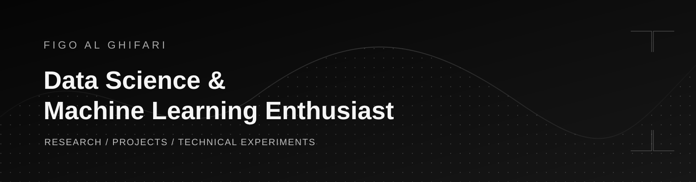

# Figo Al Ghifari

**Data Science & Machine Learning Enthusiast**

*Information Systems undergraduate at Telkom University*

[GitHub](https://github.com/Figoalghfrii) · [Repositories](https://github.com/Figoalghfrii?tab=repositories)

---

## About

I'm an Information Systems undergraduate at **Telkom University** interested in **data science, machine learning, deep learning, and computer vision**.

I enjoy exploring the full experimentation workflow: preparing data, building reproducible pipelines, implementing models, evaluating results, and documenting technical findings.

My work and learning interests revolve around:

- Machine learning research and feature selection
- Computer vision and image processing
- Data loading, augmentation, and pipeline performance
- Exploratory data analysis and statistical evaluation

## Technical Stack

**Programming & Data**

**ML & Computer Vision**

**Data & Developer Tools**

## Research & Experiments

I explore machine learning through implementation-driven research and controlled experiments, with an emphasis on understanding model behavior, evaluating trade-offs, and producing reproducible results.

- **Feature Selection & Robust Learning** — Exploring noise-tolerant fuzzy-rough feature selection, weighted margins, and three-way decision strategies through [DIRA](https://github.com/Figoalghfrii/dira-feature-selection).
- **Data Pipeline Performance** — Comparing storage and loading strategies such as HDF5, WebDataset, and LMDB, while measuring throughput, latency, and memory usage in the [Data Loading Benchmark](https://github.com/Figoalghfrii/dataloader-benchmark-tool).
- **Image Augmentation** — Evaluating augmentation configurations and their impact on model performance and training efficiency in the [Image Augmentation Benchmark](https://github.com/Figoalghfrii/data-pipeline-augmentation-benchmark).
- **Computer Vision** — Experimenting with face representation learning, metric learning, and verification using [ArcFace](https://github.com/Figoalghfrii/arcface-vision-engine-v2) and [Siamese Networks](https://github.com/Figoalghfrii/siamese-face-verification-lfw).
- **Fundamentals from Scratch** — Implementing neural network components with NumPy to better understand forward propagation, backpropagation, and optimization in [Neural Network Playground](https://github.com/Figoalghfrii/neural-network-from-scratch).

My experiments typically focus on:

- Establishing clear baselines and evaluation metrics
- Measuring accuracy alongside computational efficiency
- Comparing approaches under consistent experimental settings
- Documenting methodology, limitations, and findings

## Collaborative Projects

Alongside individual research, I have collaborated on team projects involving data engineering, AI systems, and software development.

- **OBOR — Wildfire Intelligence System** — Contributed to the data engineering workflow by sourcing multi-origin datasets, including satellite observations, cleaning and preparing the data, and integrating it into the project's analytical data warehouse. The broader system combines wildfire monitoring, risk analysis, and multi-agent coordination. [Repository](https://github.com/ProsperousJoy/obor)
- **Nusantara Retail Group Data Warehouse** — Developed ETL transformations for the fact tables (t_07–t_09), the main Pentaho orchestration job, and SQL queries used to validate business results across integrated retail data sources. [Repository](https://github.com/ramirezzServer/nrg-data-warehouse)
- **OurTucTuc — Campus Mobility System** — Collaborated on a Laravel-based shuttle management application. My documented contribution includes work on the vehicle management module, within a system covering routes, stops, schedules, and passenger services. [Repository](https://github.com/ramirezzServer/ourtuctuc-mobility-system)
- **SI4810-KELF — Team Software Project** — Implemented the admin account suspension and reactivation feature (PBI-19), contributing to role-based user administration in the team's application. [Repository](https://github.com/SI4810-PPL-KelompokF/SI4810-KELF)

## Research Interests

- **Machine Learning:** feature selection, model evaluation, and experimental methodology.
- **Computer Vision:** image processing, face representation learning, and image super-resolution.
- **Data Engineering:** data loading systems, ETL, storage formats, and pipeline optimization.
- **Performance Engineering:** throughput, latency, memory usage, and efficient model training.

---

*Research · Collaboration · Technical Experiments*

